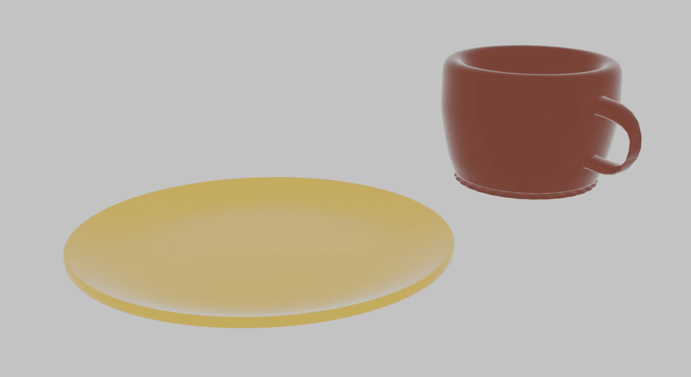

# ☕ 3D Cup and Plate Animation

A 3D modelling and animation project created using **Blender**, featuring a ceramic cup placed on a plate.

This project explores 3D object modelling, material design, lighting, scene composition, and rendering to create a simple product-style animation.

## 🎬 Animation Preview



▶️ **[Watch the Animation](0001-0120.mp4)**

## 📌 About the Project

The scene features a reddish-brown ceramic cup with a curved handle, positioned on a golden-yellow plate.

The objects are presented against a neutral background, creating a clean and minimal product-visualisation scene.

## ✨ Features

- **3D Cup Model:** A ceramic cup with a hollow opening and curved handle.
- **3D Plate Model:** A circular plate with a smooth, rounded appearance.
- **Material Design:** Contrasting reddish-brown and golden-yellow materials.
- **Scene Composition:** Minimalist arrangement of objects against a neutral background.
- **Animation:** Animated scene rendered as a video.
- **Lighting and Rendering:** Smooth surfaces and soft lighting for a product-style appearance.

## 🛠️ Tools & Technologies

| Tool | Purpose |
|---|---|
| Blender | 3D modelling and animation |
| Material Editor | Object material design |
| Lighting | Scene illumination |
| Camera | Scene composition |
| Rendering | Final animation output |

## 🎞️ Animation Specifications

| Specification | Value |
|---|---|
| Resolution | 1920 × 1080 |
| Frame rate | 24 FPS |
| Duration | Approximately 4.7 seconds |
| Output format | MP4 |

## 📂 Project Structure

```text
blender-3d-cup-and-plate-animation/
├── cup_plate_25255440.blend
├── 0001-0120.mp4
├── cup_plate_preview.png
└── README.md
```

## 🚀 How to View

1. Clone or download this repository.
2. Open `cup_plate_25255440.blend` in Blender.
3. Explore the 3D scene and animation timeline.
4. Play the rendered video to view the final animation.

## 📚 Learning Outcomes

This project provided an opportunity to explore:

- 3D modelling of everyday objects
- Material creation and colour selection
- Lighting and scene composition
- Camera positioning
- Animation and rendering
- Product-style 3D visualisation

## 👩‍💻 Author

**Beulah Supragnya Pamula**

MSc Computer Science (Applied)  
Maynooth University, Ireland

---

*Created using Blender as part of my 3D graphics journey.*
